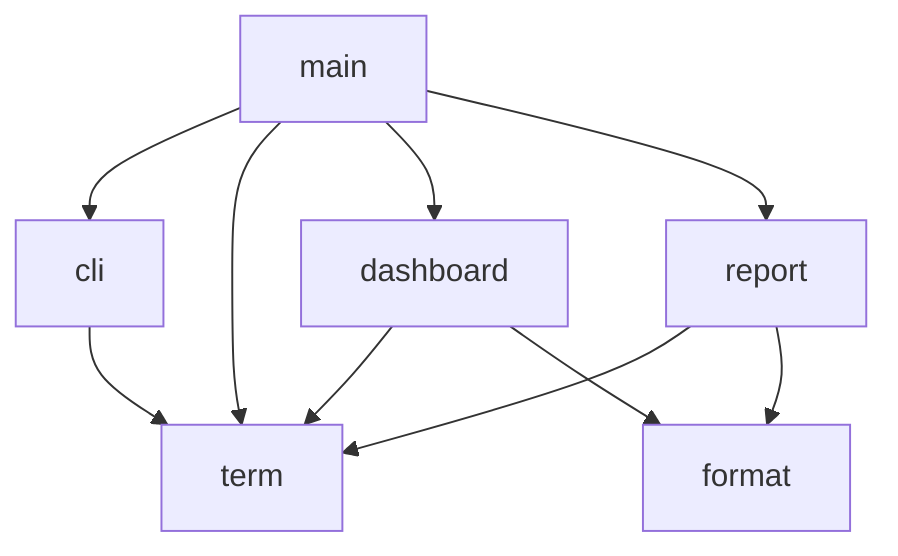

# whichdns polish design

Date: 2026-10-09

## Goal

Make the command-line tool read as a finished product instead of a prototype.
The benchmark engine, scoring, and resolver list do not change.

## Decisions

- Name: `whichdns`.
- Version: `0.2.0`.
- Final table: compact by default, `--wide` shows every column.
- End of run: one-line recommendation plus a one-line pass count.
- Code structure: split `src/app/main.zig` into focused files. No new dependencies.

## Modules



| File | Purpose |
| --- | --- |
| `src/app/main.zig` | Parse options, run the benchmark, hand results to the report. |
| `src/app/cli.zig` | `Options` struct, argument parsing over a string slice, help text, usage errors. |
| `src/app/term.zig` | Buffered stdout and stderr writers, color detection, style codes, cursor hide and show, SIGINT restore. |
| `src/app/format.zig` | Number formatting: unsigned, milliseconds, seconds, `m:ss` durations, padding. |
| `src/app/dashboard.zig` | Live progress view for a TTY. |
| `src/app/report.zig` | Final ranked table, column selection, resolver list, verdict lines. |

## Identity

- Binary name `whichdns` in `build.zig`, `justfile`, `scripts/release-macos.sh`, and the README.
- Release artifact `dist/whichdns-macos-<arch>`.
- `src/zig/version.zig` becomes `0.2.0`.
- Build step descriptions do not say "prototype".
- Run banner:

```
whichdns 0.2.0
Testing 126 resolvers over UDP: 3 passes, 1500 ms timeout, uncached lookups off
```

  With `--uncached-zone example.net` the last clause reads `uncached lookups under example.net`.

- README title `whichdns`. Sections: what it does, install from release or build from source, usage, how ranking works, the resolver list, development (test, release script, size baseline).

## Command line

Options and ranges stay the same. New flags:

| Flag | Meaning |
| --- | --- |
| `--wide` | Show every measurement column. |
| `--no-color` | Disable color. |

Help output:

```
whichdns 0.2.0
Benchmark public DNS resolvers from this machine and rank them by latency.

Usage: whichdns [options]

Options:
  --top N               Show only the N best resolvers (default: all)
  --iterations N        Full passes per resolver, 1-100 (default: 3)
  --timeout-ms N        Per-query timeout in ms, 1-60000 (default: 1500)
  --retries N           Retries per failed query, 0-10 (default: 0)
  --pause-ms N          Pause between queries to one resolver in ms, 0-1000 (default: 20)
  --threads N           Concurrent workers, 1-64 (default: one per resolver, max 32)
  --uncached-zone ZONE  Also measure uncached lookups under a wildcard zone you control
  --wide                Show every measurement column
  --no-color            Disable colored output (NO_COLOR is also honored)
  --list                Print the built-in resolver list and exit
  --version             Print the version and exit
  -h, --help            Show this help and exit
```

Usage errors go to stderr with exit code 2:

```
whichdns: --timeout-ms must be between 1 and 60000, got 0
Try 'whichdns --help' for more information.
```

Error forms:

- `unknown option '--bogus'`
- `--top needs a value`
- `--top must be between 1 and 126, got 0`
- `--uncached-zone must be 1-240 characters`

Runtime failures (runner or ranking) go to stderr with exit code 1:
`whichdns: benchmark failed: <error name>`.

## Color

Color is on when all of these hold: stdout is a TTY, `NO_COLOR` is unset,
`TERM` is not `dumb`, and `--no-color` is absent. Styles used: bold, dim,
green, yellow, cyan. All styles reset at the end of each line.

## Dashboard

Shown only when stdout is a TTY. Redraws at most every 100 ms, as now.

```
Validating resolvers  ████████████░░░░░░░░░░░░░░░░░░  43%  54/126   0:04 elapsed, ~0:06 left
   #  Resolver               Address            Avg ms  Success
   1  Quad9                  9.9.9.9              14.2     100%
   2  AdGuard DNS            94.140.14.14         14.2     100%
  10  ·
```

- Phase label is `Validating resolvers` or `Benchmarking`, padded to a fixed width, bold.
- Bar is 30 cells. Unicode `█` and `░` when `LANG`, `LC_ALL`, or `LC_CTYPE` contains `UTF-8` or `utf8`. Otherwise `#` and `-`. Filled part is cyan.
- Elapsed is `m:ss` from run start. ETA appears after the phase passes 5 percent and reads `~m:ss left`. ETA uses phase elapsed divided by phase fraction done.
- Top rows: rank, name (21 cols), address (18 cols), average ms, success percent. Header row is dim. Empty slots print the rank and a dim `·`.
- The cursor hides at the first draw and shows again after the final draw.
- A SIGINT handler writes cursor-show and style-reset to stdout, then exits with 130. The handler installs only when the dashboard is interactive.

## Final report

Column set:

| Column | Default | Wide | Note |
| --- | --- | --- | --- |
| `#` | yes | yes | rank |
| `Resolver` | yes | yes | |
| `Address` | yes | yes | |
| `Status` | conditional | yes | shown when any printed row is not reachable |
| `Avg ms` | yes | yes | |
| `Min ms` | yes | yes | |
| `Max ms` | yes | yes | |
| `Cached ms` | no | yes | |
| `Uncached ms` | conditional | yes | shown when `--uncached-zone` is set |
| `.com ms` | no | yes | |
| `Std dev ms` | no | yes | |
| `Jitter` | yes | yes | percent |
| `Success` | yes | yes | percent |
| `Score` | yes | yes | |

Header row is bold. Text columns align left, numbers right. Status cells are
green for `reachable` and yellow for every other status.

After the table, one blank line, then:

```
Showing 8 of 126 resolvers.
Fastest reliable resolver: AdGuard DNS (94.140.14.14), 14.2 ms average.
118 of 126 resolvers answered every lookup in 14.5 s.
```

- The `Showing` line is dim and appears only when `--top` hides rows.
- The recommendation names the rank-1 row when its status is `reachable`. When no row is reachable the line reads `No resolver answered every lookup.`
- The pass count counts rows with status `reachable`.

The `--list` output keeps its three columns with capitalized headers
(`Resolver`, `Address`, `Port`) and a footer `126 built-in resolvers`.

## Non-TTY output

No dashboard. The banner, table, and verdict print without color. This is the
output a user gets when piping to a file.

## Tests

A second `zig build test` artifact covers `src/app`. Tests cover:

- `cli.parse` on string slices: defaults, every flag, each error form, `--help` and `--version` early exits.
- Help text contains every flag name.
- `format`: milliseconds with one decimal, seconds with one decimal, `m:ss`.
- `report.selectColumns`: default, wide, uncached set, non-reachable row present.
- `dashboard.etaSeconds`: zero before 5 percent, correct ratio after.
- `report.writeVerdict` into a buffer for the reachable and no-reachable cases.

## Out of scope

Scoring, ranking, the resolver list, the UDP runner, and the size baseline
numbers in the README.
